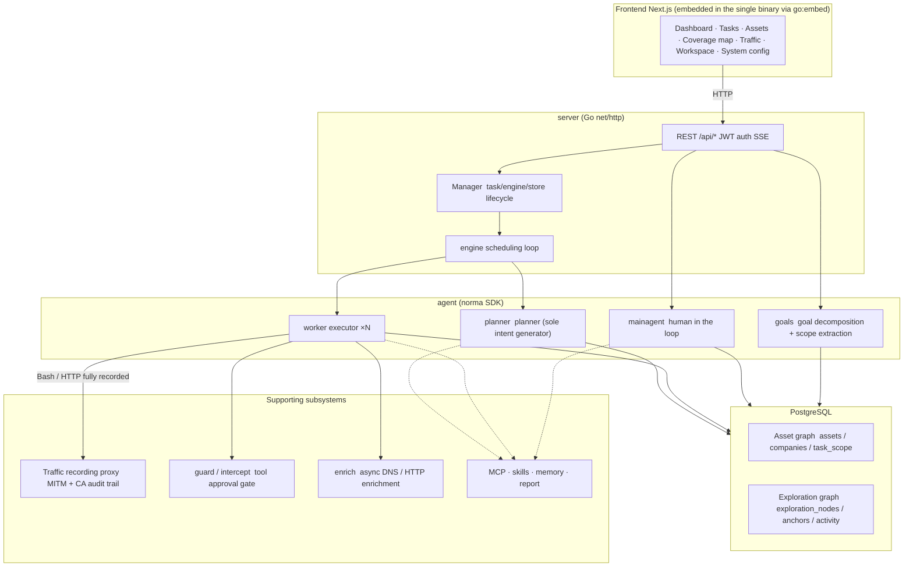
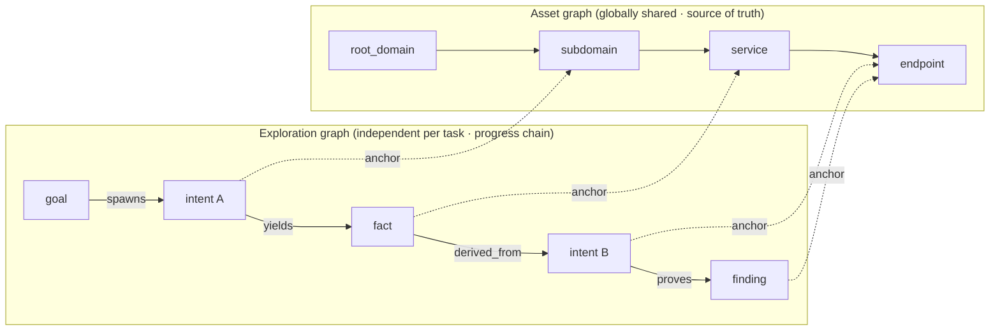
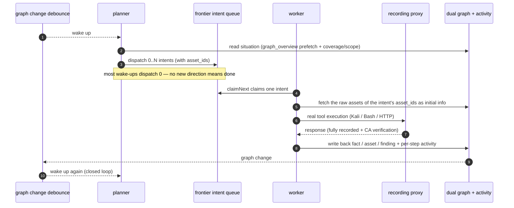
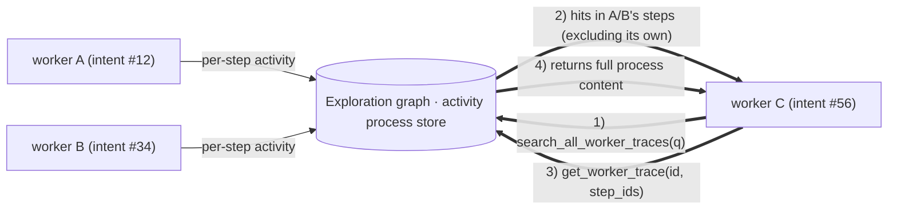
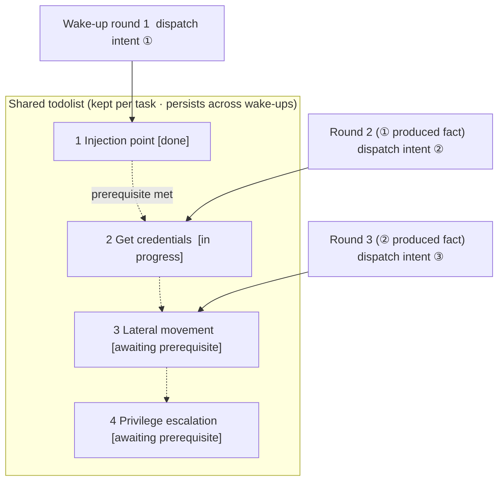

<div align="center">

# Elenxa

Autonomous penetration-testing agent (Go backend + Next.js frontend), from [Aporixa](https://aporixa.com)

</div>

> *Elenxa* comes from the Socratic *elenchus*: questioning a claim until it gives way and exposes what was not
> understood (*aporia*). That is what this tool does to a target.

**Use it only against systems you own or are explicitly authorized to test.** Read [SECURITY.md](SECURITY.md) first.

## Origin

Elenxa is a derivative of **ARTEX v0.3.15** by Autumn-27, an LLM multi-agent penetration-testing system released
under AGPL-3.0. The original repository is no longer available; exact source and verification details are in
[PROVENANCE.md](PROVENANCE.md). Elenxa also includes a patched copy of [Norma](https://github.com/Autumn-27/Norma)
(Apache-2.0) in `third_party/norma`. Elenxa is not affiliated with or endorsed by the ARTEX authors.

## Hardened build

Differences from upstream ARTEX:

- **Localhost only** — `docker-compose.yml` publishes 8787/8788 on `127.0.0.1` only; PostgreSQL is not published to the host at all. Use an SSH tunnel for remote access.
- **No self-update** — the in-app updater, `update.sh`, the update badge/card and the exit-code-75 restart loop are gone. `start.sh` just `exec`s the binary. Upgrades are done by rebuilding from source you have reviewed.
- **Local build from pinned inputs** — the `Dockerfile` is a multi-stage build from digest-pinned base images: `npm ci --ignore-scripts` from `package-lock.json`, Go built offline from `vendor/` (`GOFLAGS=-mod=vendor GOPROXY=off GOTOOLCHAIN=local`). No prebuilt images, no NodeSource, no `npx`/`@latest`, no Playwright downloads. Run `go mod vendor` before building. Next.js telemetry is disabled and no Google Fonts/CDN/analytics are fetched.
- **Setup token** — the first admin setup requires a one-time token. It is printed in the server log and written to `setup-token` in the key directory — next to the binary for local builds, `$ELENXA_KEY_DIR` if set (`docker compose logs elenxa | grep -i setup`, or `docker compose exec elenxa cat /app/keys/setup-token`). `jwt.key` lives in the same directory, outside the browsable data dir.
- **Own browser MCP** — browser automation uses `elenxa-browser-mcp` (built from `cmd/elenxa-browser-mcp`), which drives the system Chromium over the DevTools pipe instead of `@playwright/mcp`.
- **Removed** — ScopeSentry asset sync, the `playwright-cli` / `scopesentry` skills, GitHub workflows, the bench compose file. The container runs as non-root user `elenxa` (uid 10001).

Quick start:

```bash
go mod vendor            # once, on a machine you trust
./install.sh             # choose 1: generates .env (random POSTGRES_PASSWORD), builds, starts
# → http://127.0.0.1:8787 ; enter the setup token from the log on first visit
```

The original (upstream) documentation follows; installation/update instructions below have been adapted to the hardened build.

---

## Approval record details

The global "Approval records", the in-task "Interception approvals" and the approval cards in chat all support expanding to view details. The layout is modeled on
[AegisHook's approval detail component](https://github.com/RuoJi6/AegisHook/blob/main/web/src/components/CallDetail.vue), using Elenxa's own components and theme:


---

## Installation

> Requires a **PostgreSQL** database; exploration requires an **LLM** to be configured (`ANTHROPIC_API_KEY` or `OPENAI_API_KEY`, or configure it in the UI).
> All methods **build from local source**; run `go mod vendor` once in the source directory first.

### Option 1: install script (recommended)

```bash
cd elenxa-clean
go mod vendor
./install.sh
```

The script does not install Docker or pull any prebuilt images (docker / docker compose must be installed beforehand), and lets you choose:

- **① Docker (local build)**: generates `.env` if missing (random `POSTGRES_PASSWORD`, mode 600) → `docker compose build` → `docker compose up -d`, and tells you how to view the setup token.
- **② Local compile**: connects to an existing PostgreSQL → generates `config.json` → `npm ci --ignore-scripts` + static export → compiles `elenxa` and `elenxa-browser-mcp` offline → starts on `127.0.0.1`.

Once installed, open **http://127.0.0.1:8787**; the first visit goes to `/setup`: enter the **Setup token** (from the server log / `setup-token` in the key directory; `/app/keys/setup-token` for Docker) and set the admin password.

### Option 2: Docker Compose (manual)

```bash
go mod vendor
# .env must contain at least POSTGRES_PASSWORD (e.g. generated with openssl rand -base64 32); chmod 600 .env
docker compose build          # build elenxa:local locally
docker compose up -d
docker compose logs elenxa | grep -i setup   # setup token for first-time initialization
# → http://127.0.0.1:8787
```

The image includes common tools (ripgrep/curl/vim-tiny/nmap/chromium…) and runs as the non-root user `elenxa`; the data directory is the named volume `elenxa-data`, and `./skills` is provided as a bind mount.

Remote MCP can be set to `http` (Streamable HTTP) or `sse` (legacy SSE) in System settings.
Legacy SSE services usually use `GET /sse` to establish the event stream, then receive JSON-RPC requests at the
`/message?sessionId=...` returned by the service; when configuring, set the URL to `/sse` and fill in the request header as
`Authorization=Bearer <token>`.

### Option 3: compile a single binary from source

```bash
export GOFLAGS=-mod=vendor GOPROXY=off GOTOOLCHAIN=local NEXT_TELEMETRY_DISABLED=1
# 1) Static frontend export
cd web && npm ci --ignore-scripts && npm run build:static && cd ..
# 2) Copy into the embed directory
cp -r web/out server/webui/dist
# 3) Compile (the frontend is embedded only with -tags embedui)
CGO_ENABLED=0 go build -tags embedui -trimpath -o elenxa ./cmd/elenxa
CGO_ENABLED=0 go build -trimpath -o elenxa-browser-mcp ./cmd/elenxa-browser-mcp
./start.sh -addr 127.0.0.1:8787 -proxy 127.0.0.1:8788
```

`build.sh` can also be used for local builds / packaging (likewise offline, `--ignore-scripts`); see the notes at the top of the script.

---

## Upgrading

This hardened build has **no auto-update / one-click update**, and does not pull prebuilt images or Release packages. To upgrade: review the new source → `go mod vendor` → rebuild:

```bash
docker compose build && docker compose up -d     # Docker
# or recompile the single binary per "Option 3" and restart
```

Upgrading replaces only the program, not the data: the Postgres data volume `pgdata` and `elenxa-data` are both kept. **Database migrations need no manual steps** — `elenxa` idempotently re-runs `schema.sql` on every start, i.e. "restart = migrate". Backing up the data volumes and database before upgrading is still recommended.

---

## Configuration

**Database** (`config.json`, or override with the environment variable `ELENXA_PG_DSN`):

```json
{
  "database": {
    "host": "127.0.0.1", "port": 5432,
    "user": "elenxa", "password": "yourpass",
    "dbname": "elenxa", "sslmode": "disable"
  }
}
```

**LLM**: `export ANTHROPIC_API_KEY=sk-...` (or `OPENAI_API_KEY`), or fill it in on the "LLM configuration" page in the UI.
Optional: `ELENXA_LLM_PROVIDER` / `ELENXA_LLM_MODEL` / `ELENXA_LLM_BASE_URL` / `ELENXA_LLM_PROXY`.

**Concurrency**: the number of work agents per task is configured in "System settings" (default 3).

**Common flags**: `./start.sh -addr 127.0.0.1:8787 -proxy 127.0.0.1:8788` (`-addr` frontend + API, `-proxy` traffic recording proxy). The start script passes the flags through to `elenxa` unchanged.

### Reverse proxy deployment (HTTPS / only 443 exposed)

The frontend and API/SSE are all served from the same backend port (default `:8787`), and the live activity feed uses the **same-origin** address by default, so there is **no need to configure `NEXT_PUBLIC_SSE_BASE`**: expose only 443 publicly and keep 8787 on the internal network.

SSE is a long-lived connection with continuous push, so the reverse proxy **must disable buffering**, otherwise the browser can connect but receives no events (the activity feed keeps spinning). Nginx example:

```nginx
server {
    listen 443 ssl;
    server_name your.domain.com;
    # ssl_certificate / ssl_certificate_key ...

    location / {
        proxy_pass http://127.0.0.1:8787;
        proxy_set_header Host $host;
        proxy_set_header X-Forwarded-Proto $scheme;

        # SSE essentials: no buffering, long timeout, HTTP/1.1
        proxy_buffering off;
        proxy_cache off;
        proxy_read_timeout 3600s;
        proxy_http_version 1.1;
        proxy_set_header Connection "";
    }
}
```

> Set `NEXT_PUBLIC_SSE_BASE` at **build time** only when SSE must use a different origin from the page (e.g. a separate subdomain) (the variable is baked into the static bundle at `next build`; setting it at container runtime has no effect).

---


## Development

### Manual vulnerability retest

The "Retest" tab in task details lets you page through this task's vulnerabilities, view past verdicts and evidence, and manually start a retest. After starting, the current tab stays open, showing a spinner and "Retesting"; once a fix is confirmed the vulnerability status is updated accordingly.

Click "Retest" in the action area of each row in the vulnerability list, or click "Start retest" in the "Vulnerability retest" section of the vulnerability details, and fill in an optional fix version, test conditions or constraints; the system creates a separate retest Agent session and keeps you on the current page after starting. The flat list, group-by-task and asset views all support this entry point; while a retest runs, a spinner and "Retesting" are shown, click into the corresponding session when you need to look at it, and it returns to "Retest" when done. A retest does not require restarting the original scan task; verdicts are "Still reproducible", "Fixed" or "Unable to confirm", and each verdict, its evidence and session link are saved in the vulnerability details.

On first start the new backend seeds an editable "Vulnerability retest" (`retester`) Agent, whose prompt, LLM, run budget and tools can be configured in Agent management. It uses its bound LLM by default, or the globally active configuration if none is bound. When a retest session completes successfully with the verdict "Fixed", the system automatically changes the vulnerability's handling status to "Fixed"; running, failed, stopped or other verdicts keep the original status. Original evidence and reports are always kept. You can also select "Fixed" manually in the status dropdown. If the same vulnerability is already being retested the existing session is reused; after a stop, failure or service restart it can be started again.

In this version the history is viewed through the vulnerability details and sessions; it is not yet included in vulnerability report exports or task archive packages, nor automatically linked to traffic packets. Demo mode generates only clearly labeled simulated records and makes no requests to real targets.

### Running and testing locally

```bash
./dev.sh    # backend (:8787) + traffic proxy (:8788) + frontend next dev (:5173) → http://localhost:5173
```

- Backend: `go run ./cmd/elenxa` (without `-tags embedui` the frontend is not embedded)
- Frontend: `cd web && npm run dev` (`/api` is reverse-proxied to the backend, with hot reload)
- Tests: `go test ./...`
- Mock preview (no backend): `cd web && NEXT_PUBLIC_MOCK=1 npm run dev`


---

## System architecture

Elenxa is an **LLM multi-agent-driven autonomous penetration testing system**: a Go monolith backend (with the Next.js frontend embedded) + PostgreSQL, with agent capabilities provided by the [`norma`](https://github.com/Autumn-27/norma) SDK (`agentcore` / `tool` / `permission` / `harness` / `memory` / `transcript`). At its core is a **dual-graph architecture**, plus two autonomy mechanisms built around it: **process-level information exchange between workers** and **a todolist shared by the planner across rounds to stabilize attack chains**.

### Overall layers



| Layer | Responsibility |
| --- | --- |
| **Frontend** | Next.js static export, embedded into the single binary via `go:embed`; visualizes tasks/assets/exploration chains/coverage map, human-in-the-loop chat |
| **server** | `net/http` routing + JWT auth + SSE; `Manager` hosts the lifecycle of tasks, engines and DB stores |
| **engine** | One `plannerLoop` + N worker goroutines per task; intent claiming, timeout/pause/drain |
| **agent** | goals / planner / worker / mainagent; `ToolSet` exposes the dual graph as LLM tools |
| **db** | Postgres persistence of the dual graph (pgx); the schema is embedded via `go:embed` and tables are created idempotently on every start |
| **Supporting** | Recording MITM proxy, approval gate, async enrichment, MCP/skills/memory/reports |

### Dual-graph architecture: exploration graph + asset graph

The system splits "**what the target is**" and "**how far it has been tested**" into two graphs that are independent of each other yet connected by anchors:

- **Asset Graph (globally shared)**: a single cross-task source of truth for assets. Nodes are `root_domain / subdomain / ip / service / app / endpoint`, belonging to companies; the domain → subdomain → service → endpoint parent-child relations and dedup keys are all computed by the program, and the agent only submits raw information.
- **Exploration Graph (independent per task)**: the "thinking and progressing" process of one task. Nodes are `goal / intent / fact / finding (vulnerability) / hint`, linked by edges such as `spawns / derived_from / yields / proves` into a **lineage chain**, answering "which direction was derived from which facts, and what did it produce".
- **The two graphs are connected by anchors**: `exploration_anchors(node_id, asset_id)` anchors intents/facts/findings to specific assets — so you can see from an "exploration direction" which assets it hit, and from "an asset" look up which intents tested it in this task and which facts were derived. This also powers **asset test coverage** and the **asset coverage map** (in-scope assets + tested highlighting).



> Division of labor: the **planner** reads the exploration graph situation, judges the goal, and dispatches **intents** into the frontier only when there is an uncovered new direction; a **worker** claims **one intent**, executes it with real tools, writes new assets/facts/findings back into both graphs, and then stops. The asset graph is shared fact; the exploration graph is each task's progress chain.

### Engine and intent lifecycle (the closed loop of one exploration)

The engine is an **event-driven** closed loop: any graph change wakes the planner, the planner dispatches intents, workers claim intents, execute and write back, and the write-back triggers the next round — until the goal is proven (`prove_goal`).



### Process-level information exchange between workers

In a deep exploration, many valuable observations (an error message, a response snippet, a hidden parameter) appear in one worker's **execution process** without necessarily being written up as a formal fact. To avoid duplicated work and let workers along the chain stand on each other's shoulders, workers can **search processes across works**:

- `search_all_worker_traces(q)`: keyword search over **the execution processes of other works in this task** (automatically excluding the steps of its own intent); hits carry `intent_id`;
- `list_worker_traces` / `get_worker_trace(intent_id, step_ids=[…])`: first see which works have run, then fetch the full content of specific steps of a work for detailed exchange.

So even when the exploration graph has no corresponding fact yet, later workers can reuse observations from others' processes — **information flows between workers at the granularity of the "execution process"**, while the boundary stays the same (each worker still works only on the one intent it claimed).



### Planner todolist shared across rounds → stable attack chains

Real attack chains are often **multi-step sequences with dependencies** (e.g. find an injection point → obtain credentials → move laterally → escalate privileges); dispatching them all in parallel at once only creates chaos. The planner therefore holds a **planning todo list (todolist) kept per task and shared across wake-ups**:

- The planner is event-driven — woken whenever the graph changes, but **each wake-up is a brand-new session**; the shared todolist lets it **record** a serial exploitation chain **once**, then **dispatch intents step by step according to dependencies** over the following rounds, rather than front-loading the whole chain in one round;
- Each round dispatches intents only for next steps whose "prerequisite steps are done and whose dependent facts exist", and updates the list as progress is made (marking steps satisfied by facts as done).



So in an "event-driven + stateless session" environment the attack chain still **progresses steadily, without repetition or misordering** — this is the key to Elenxa being able to complete multi-step exploitation chains autonomously.

---

## References

https://github.com/oritera/Cairn


## License

Elenxa is free software under the **GNU Affero General Public License v3.0** ([LICENSE](LICENSE)), the same license
as the ARTEX code it is derived from. Changes are recorded in [CHANGELOG.md](CHANGELOG.md) and
[PROVENANCE.md](PROVENANCE.md). The bundled Norma library is under the Apache License 2.0
(`third_party/norma/LICENSE`).

If you modify Elenxa and let others use it over a network, AGPL-3.0 section 13 requires you to offer them the
complete corresponding source code.

**Additional terms removed.** The original ARTEX README and login screen carried usage restrictions and a disclaimer
added by its author on top of AGPL-3.0. Under AGPL-3.0 section 7, such further restrictions may be removed by
recipients, and Elenxa does not carry them. Intended use, operating guidance and the disclaimer for this project are
in [SECURITY.md](SECURITY.md).
