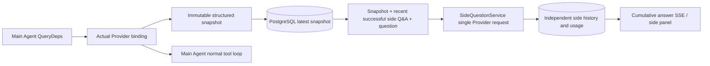

# Elenxa `/btw`

Plain chats, the task MainAgent and the current task's own Workers support independent side questions. Type `/btw question` in the main input box to submit; an empty `/btw` or the "Side question" button opens the history. Desktop uses a resizable side panel; mobile uses a Drawer.

Side answers are generated from a snapshot of the Agent context taken at submission time, and support streaming display, follow-ups, stopping and clearing. Closing the panel, refreshing the page or dropping the SSE connection does not cancel the model request. Stopping affects only the current side question; clearing cancels the side question and deletes the side history, while keeping the main context snapshot.

## Implementation boundaries

Reuses Go, norma v0.3.7, Next.js and the existing Markdown / ResizablePanel / Drawer / AlertDialog components; norma's source was not modified and no dependencies were added for side questions. The Planner, Workers inherited from other tasks, and tool-type subtask upgrades are out of scope for this change.

- `capture.go` marks main-loop requests only in `Options.Deps.CallModel / CallModelSync`. The Provider decorator sits inside the concrete model, after the outer routing-pool selection, so it records the model actually selected; compaction and summary requests do not overwrite the snapshot.
- Snapshots are published at request start, on a complete model reply, and at the run's terminal state. A half-generated reply is not published; tool calls stay paired through norma's `MessagesForAPI`, and tool results enter the snapshot at the next main model request or at the run's terminal state. A streaming abort keeps the previous valid boundary.
- Snapshots keep structured messages, system prompts, tool definitions and generation parameters via a JSON deep copy. Model inference holds neither the snapshot lock nor a database transaction.
- `SideQuestionService` calls the concrete Provider; when needed it first generates a side summary, and the final answer is allowed one retry after shrinking only if the first attempt exceeds the context limit and no text/tool call has been output yet. It does not create an agent session, and is not wired into the tool executor, the main transcript, the activity stream or the task graph, nor does it go through the task model switching chain. The answer keeps tool definitions for compatibility with the existing structured tool context; summary requests provide no tools. Newly returned tool calls have no execution path.
- One running request per parent session, at most four per service process, with a 120-second timeout per request. Side questions use an independent cancellation context under the service lifecycle.
- Side requests keep a model configuration reference and a non-sensitive identity summary; credentials are taken from the existing configuration at request time. If the configuration is deleted, or identity fields such as the model, protocol or address change, the main Agent must be run first to refresh the snapshot. Tests do not change the product's default model.

## Persistence and recovery

`db/schema.sql` automatically creates `side_question_sessions` and `side_question_requests`. The former stores the parent resource, latest snapshot, run number, version and clear version; the latter stores the question, cumulative answer, status, model, snapshot time, usage, event sequence number and pagination ordinal.

The parent session key is the conversation ID, or task ID + exploration ID + intent ID. Workers are not keyed by reusable execution slot names.

Snapshots are merged and written per parent session, flushed every 250 ms, and the database compares `(run_id, version)` to prevent an old version from overwriting a newer one. The selected snapshot is saved again before a side question is submitted. After a successful save the large in-memory snapshot is released; on failure the pending version is kept. Cumulative answer content is written at most every 250 ms as streaming events arrive; the terminal state is saved immediately, with limited retries on database errors.

On service start, leftover `running` requests are marked `interrupted`, keeping any partial answer and usage already persisted; requests are not replayed automatically. The most recently saved context can be used directly for the next question. When an old session has no snapshot, the main Agent must be run first; context is not rebuilt from UI activity records.

Clearing increments the clear version and deletes requests; a conditional update prevents late callbacks from writing back. Physical deletion of a parent resource relies on foreign key cascades; logical deletion of a Worker deletes side data in the same transaction and rejects late snapshots. Task archiving first blocks new requests, waits for the main flow to stop, then cancels and waits for side data to persist; the archive format is v3, while staying compatible with v1/v2 archives that have no side tables.

History is kept in full, with at most 20 items per page by ordinal cursor. A model request replays at most the original text of the 20 most recent successful Q&A pairs, also limited by a token budget; older Q&A is kept in an independent rolling summary. When the main context exceeds the budget, only the old part of the side copy is summarized, keeping recent structured tool calls and results. Summaries and preparation progress fall under the same concurrency, cancellation and 120-second timeout limits as side usage. See [Context budget and open-source references](CONTEXT_BUDGET.md).

## HTTP contract

The following paths serve as `{parent}`, reusing the existing authentication and resource checks:

- `/api/conversations/{id}`
- `/api/tasks/{id}/chat`
- `/api/tasks/{id}/intents/{iid}`

| Request | Response and behavior |
| --- | --- |
| `GET {parent}/side-questions?before={ordinal}` | `items` ordered newest to oldest, an independent `current` run state, `snapshot` metadata, `next_cursor`; a cursor of 0 means latest page / no next page |
| `POST {parent}/side-questions` | JSON `{ "question": "…", "client_request_id": "UUID" }`; a new request returns 202 with the request object; the same ID and question returns the existing object with 200 |
| `DELETE {parent}/side-questions` | Cancel and clear the current parent session's side Q&A |
| `GET /api/side-questions/{requestID}/events` | `snapshot` SSE events, where `id` is an increasing sequence number and `data` is the full cumulative request object; `cleared` is sent on clear |
| `POST /api/side-questions/{requestID}/cancel` | Explicit cancel; the terminal state can be read from history or SSE |

Questions are capped at 4000 characters. No snapshot, a changed model configuration, a busy parent session or an idempotency ID conflict return 409; the global concurrency limit returns 429. Every SSE connection first sends the cumulative state and does not depend on text fragments the client received earlier. The frontend merges by request ID + sequence number, and discards old callbacks when switching parent sessions or clearing.

## Validation and references

(Validation notes were removed from this copy.)

The independent request follows [Grok CLI side-question.ts (pinned commit)](https://github.com/superagent-ai/grok-cli/blob/fb97af83f06dca873281d60168430f06c8de6324/src/utils/side-question.ts), and run isolation follows [OpenCode (pinned commit)](https://github.com/anomalyco/opencode/tree/b3f1a96c6dd7adeb28b36dd11add1998fc84d67b). Elenxa's context uses norma's structured messages, rather than stitching text together from frontend logs.
